  

  

  
  

  
  
  

  

  

  <a href="https://x.com/Mhmadhassnz">X</a> &nbsp;·&nbsp;
  <a href="https://huggingface.co/Mhmadhassnz">Hugging Face</a> &nbsp;·&nbsp;
  <a href="https://mhmadhassn.social">mhmadhassn.social</a> &nbsp;·&nbsp;
  <a href="https://github.com/Moha2005269/agentgo/releases/latest">Download AgentGo</a>

